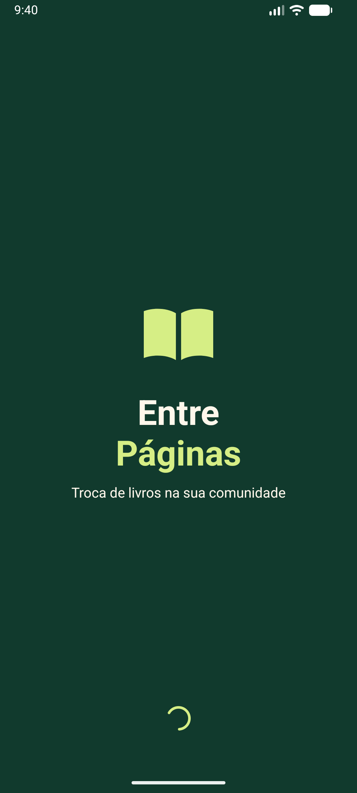
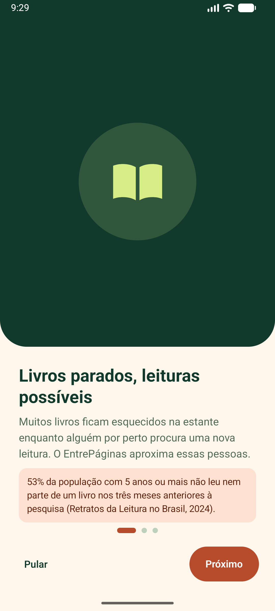
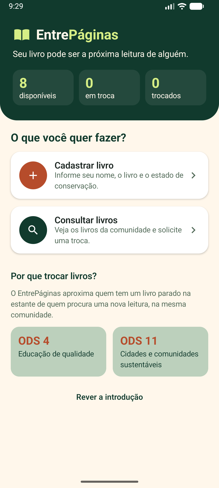
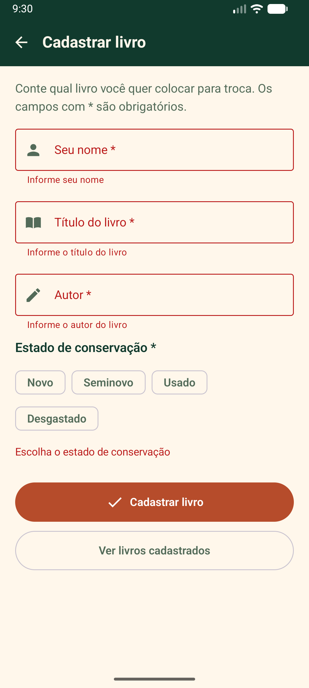
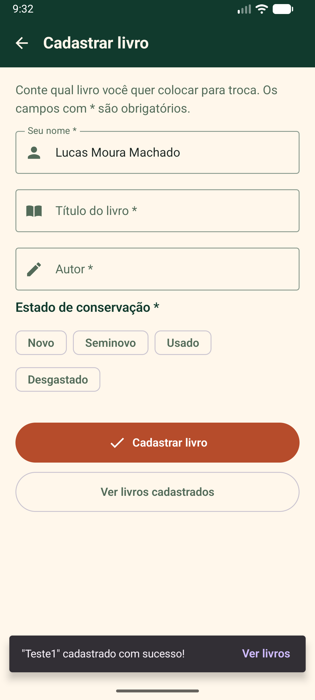
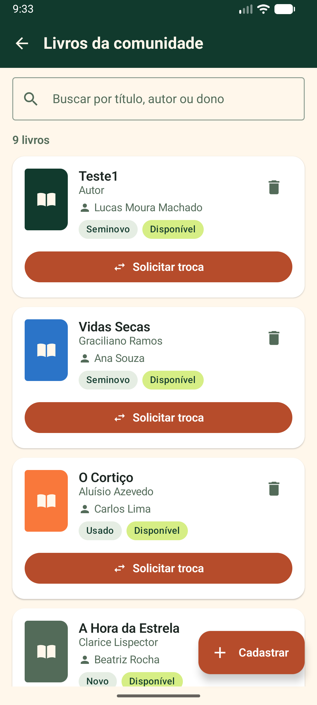
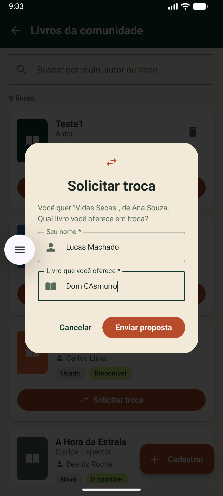
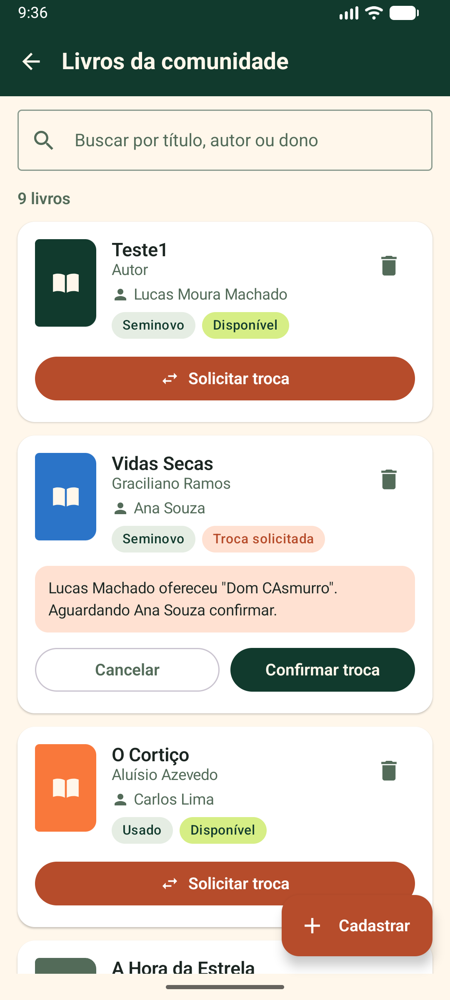

# EntrePáginas

App Android para troca de livros entre pessoas da mesma comunidade.

Global Solution 2026 (2º semestre) - Android Kotlin Developer - CitizenTech.

## Equipe

- Lucas Moura Machado - RM 557431
- Pedro Salimon - RM 555038

Link Git: https://github.com/Lucas-machad0/EntrePaginas
Link Video Pitch: https://youtu.be/ebd9bzw46U0?is=txWetNM5rvELP7IF

## Problema

Muitos livros ficam parados na estante depois de lidos, enquanto outras pessoas querem ler e não têm acesso a eles. Segundo a pesquisa Retratos da Leitura no Brasil (2024), 53% da população com 5 anos ou mais não leu nem parte de um livro nos três meses anteriores à pesquisa.

## Público beneficiado

Leitores de um mesmo bairro, condomínio, escola ou grupo de leitura.

## Proposta

O app permite cadastrar livros para troca, consultar os livros da comunidade e solicitar uma troca oferecendo outro livro. Os dados ficam salvos no próprio celular. Os livros que já aparecem no app e seus donos são dados de exemplo.

## ODS

- ODS 4 - Educação de qualidade: facilita o acesso a livros sem custo.
- ODS 11 - Cidades e comunidades sustentáveis: incentiva a troca entre vizinhos e o reaproveitamento de livros.

## Funcionalidades

- Splash e introdução em carrossel (a introdução aparece só na primeira vez).
- Tela inicial com o total de livros disponíveis, em troca e trocados.
- Cadastro de livro com nome, título, autor e estado de conservação, com validação dos campos.
- Lista de livros com busca por título, autor ou dono.
- Solicitar troca, cancelar, confirmar troca e excluir livro.
- Dados salvos com Room, mantidos depois de fechar o app.

## Tecnologias utilizadas

Kotlin, Jetpack Compose (Material 3), Navigation Compose, ViewModel com StateFlow, Room, Hilt e Coroutines/Flow.

## Estrutura

- `data/local`: entidade, DAO, banco Room e livros de exemplo
- `data/repository`: repositório de livros
- `data/preferencias`: guarda se a introdução já foi vista
- `di`: módulos do Hilt
- `ui`: telas, ViewModels, navegação e tema

## Como executar o app

1. Abrir a pasta do projeto no Android Studio.
2. Aguardar o Gradle Sync.
3. Rodar no emulador ou em um celular com Android 7.0 (API 24) ou superior.

## Fluxo principal

1. O app abre na splash e mostra a introdução.
2. Na tela inicial, o usuário escolhe cadastrar ou consultar livros.
3. No cadastro, informa nome, título, autor e estado do livro.
4. Na lista, solicita a troca de um livro informando seu nome e o livro que oferece.
5. O livro passa para "Troca solicitada" e a troca pode ser confirmada ou cancelada.
6. Ao fechar e abrir o app de novo, os dados continuam salvos.

## Capturas de tela

| Splash | Introdução | Tela inicial |
| --- | --- | --- |
|  |  |  |

| Validação | Cadastro | Lista |
| --- | --- | --- |
|  |  |  |

| Solicitar troca | Troca solicitada | Após reabrir o app |
| --- | --- | --- |
|  |  |  |

## Evidências

- Criação de registro: o livro "Teste1" foi cadastrado (print Cadastro) e aparece no topo da lista (print Lista).
- Ação adicional: foi solicitada a troca do livro "Vidas Secas" e o status mudou para "Troca solicitada" (print Troca solicitada).
- Permanência após reabrir: o app foi fechado e aberto de novo, e o livro cadastrado e a troca continuam salvos (print Após reabrir o app).
